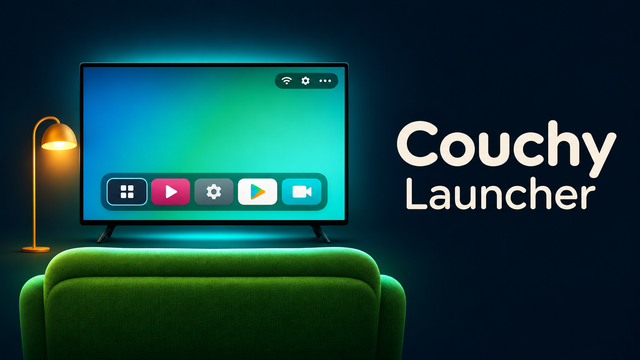
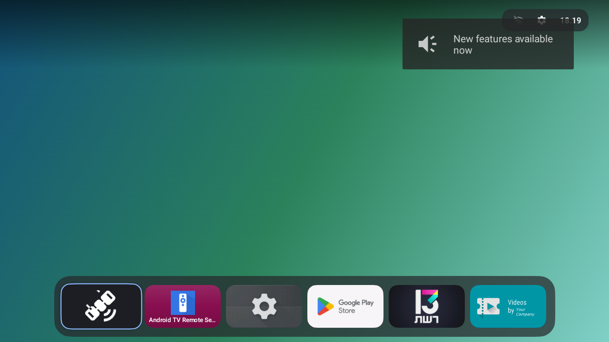
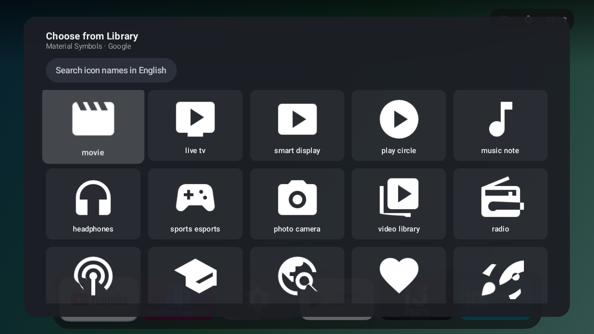
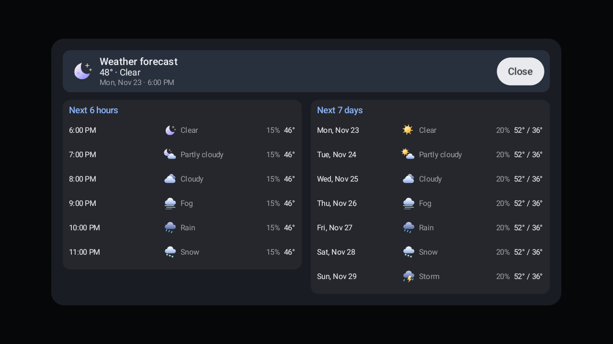
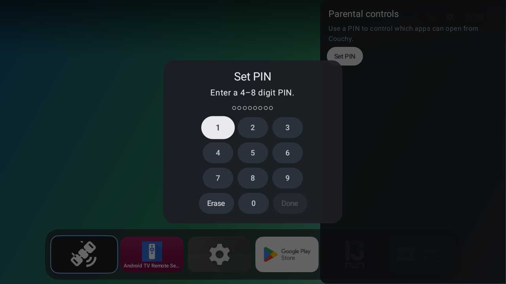

<div align="center">



# Couchy Launcher

**A fast, private, one-screen home launcher for Android TV & Google TV.**


[Install](#install) · [Contributing](CONTRIBUTING.md) · [Licensing](LICENSING.md)

https://github.com/user-attachments/assets/6f21913e-1948-4543-9983-64dc68c602fa

</div>

**An updated open-source fork.** This repository, [dikodahan/couchy-launcher](https://github.com/dikodahan/couchy-launcher), builds on the original [Couchy Launcher by conreo](https://github.com/conreo/couchy-launcher). It is maintained independently and remains licensed under GPLv3. The original author created the launcher, design and foundation; this fork adapts community contributions and adds compatibility and reliability fixes.

One screen, remote-driven, for 1080p and 4K TVs. Fresh installs start with Aerial Views video wallpapers. Weather and Telegram backup are set up separately. Settings and custom artwork are stored locally.

|                                              Launcher Home with a custom icon                                               |                                                      Offline icon library                                                      |
| :-------------------------------------------------------------------------------------------------------------------------: | :----------------------------------------------------------------------------------------------------------------------------: |
|   |  |
|                                              Weather forecast with sample data                                              |                                                       Parental controls                                                        |
|  |                  |

---

## Features

- **Built-in Home switching** - choose Couchy or keep your current launcher during setup. Launcher settings switches between Couchy and the TV’s stock launcher.
- **Three layouts** - Carousel, Grid, or a floating glass Dock (press **Down** to expand to the full grid).
- **App order:** Hold OK on an app and choose **Move**. Couchy opens a grid from the top in every layout, including Dock. Press OK to pick up an app, move it with the D-pad, and press OK again to drop it. You can move apps within or between sections, then press Back to save and exit.
- **Sections** you rename, reorder and fill. An app can appear in several. In **Settings → Sections**, select a section to rename it or choose an icon from the built-in library. For **All apps**, use the pencil next to the toggle. To move apps between sections, use **Apps reorder mode**. New installs go to the first section.
- **Wallpapers** - gradients, Top Shelf previews for compatible apps, your own photo, a looping video, or optional built-in aerial videos (Apple / Amazon / community, streamed only when enabled), with speed control and cross-fades.
- **Save & load** your full configuration — categories, layout, wallpaper, and all settings - as a JSON file.
- **19 languages** - The launcher supports both right-to-left (RTL) and left-to-right (LTR) orientation based on the selected language. Hebrew and Arabic mirror the interface, menus, dialogs, and D-pad controls. English and other LTR languages use left-to-right orientation. Choose a language in **Settings → Launcher settings → Language**, or select **System default** to follow your TV.
- **Adjustable** - icon size, spacing, corner roundness, interface scale, dimming, and an optional glass status-bar panel.
- **Status row** - clock, network state, optional VPN button, and an opt-in weather chip (Open-Meteo, no key/account/ads).
- **Reskin any app** - rename it, or swap in a custom icon/banner; or apply an installed Nova/ADW-compatible icon pack (e.g. ProjectivyIconPack) to every app that ships no banner.
- **D-pad only** - text entry happens only inside dialogs.

---

## ⚠️ Aerial wallpaper notice

Fresh installations use the built-in aerial video wallpapers by default. They stream public video files from **Apple** and **Amazon** CDNs — these are non-free, third-party services. No credentials or private data are sent, but the network traffic goes to proprietary infrastructure. If you want a fully libre setup, use the gradient, photo, or local video wallpaper options instead.

---

## Requirements

- **Android TV or Google TV** (requires the `leanback` feature — it won't install on phones/tablets).
- **Android 9 (Pie/API 28) or newer** - Android TV and Google TV devices on supported Android versions.
- **ARM (32- or 64-bit), x86 or x86_64** - one universal APK covers these architectures. The launcher, local backups and Telegram integration all require **Android 9/API 28 or newer**.
- **No dependencies** - no companion app and **no Google Play Services** required; runs on AOSP boxes too.
- Driven entirely by the **remote / D-pad**; no touchscreen needed.

---

## Top Shelf wallpaper

Open **Settings → Appearance → Wallpaper → Top Shelf** and allow access to Android TV listings. Highlight a streaming app with the remote and leave it focused. Couchy cycles through movie and TV artwork that the focused app makes available through Android TV Preview or Watch Next. The selected gradient appears when a feed or its images are unavailable. Availability varies by app and TV firmware. Top Shelf uses the platform’s read-only listings permission and is inactive while Android TV parental controls are on. The wallpaper choice is included in backups. Android asks for listings access separately on each device.

### Publishing artwork from an Android TV app

Top Shelf reads the standard Android TV home-screen feeds. A streaming app can support it with the same AndroidX TV Provider integration it uses to publish a [Preview channel](https://developer.android.com/training/tv/discovery/recommendations-channel) or [Watch Next programs](https://developer.android.com/training/tv/discovery/watch-next-add-programs). Publish records under your Android TV app’s own package so Couchy can match them to its app tile.

1. Declare `com.android.providers.tv.permission.WRITE_EPG_DATA` and use `androidx.tvprovider:tvprovider` to create a Preview channel. Publish titles with `PreviewProgram.Builder`. Use a movie, TV series, TV season, or TV episode program type. A Watch Next publisher can supply the same artwork fields with `WatchNextProgram.Builder`.
2. Set `thumbnailUri` or `posterArtUri`. A landscape thumbnail (ideally 16:9) works best for the full-screen preview. Couchy tries the thumbnail first and falls back to poster art if the thumbnail is missing or fails to load. Use an HTTPS URL that can load without private headers, or an externally readable `content://` URI from a provider owned by your app. Bundled `android.resource://` artwork can also use your app’s package as its authority. For HTTPS, keep each image at or below 8 MiB. Couchy downsamples images to fit within 1280 × 720.
3. Publish only items intended for home-screen discovery. Couchy uses entries marked searchable and browsable. It prioritizes Preview entries by weight, then fills the remaining slots with Watch Next entries by most recent engagement. It shows up to four images in a rotation and ignores private or unreadable artwork.
4. Test on an Android TV or Google TV device with Couchy’s Top Shelf and TV listings permission enabled. Highlight your app tile without pressing OK. Check that artwork appears, rotates if multiple images are available, and clears when focus moves to a different app.

Couchy reads imagery only. The app tile still launches the app normally. A TV’s provider determines which listings it shares with third-party launchers. Private in-app catalogs and proprietary launcher feeds require the app developer to publish compatible entries before Couchy can display them.

## Install

Couchy Launcher requires Android TV or Google TV running **Android 9 (API 28) or newer**.

[Download the latest signed APK](https://github.com/dikodahan/couchy-launcher/releases/latest/download/Couchy-Launcher.apk).

### Install with Downloader

1. **Get the APK.** Open **Downloader** on your TV, enter code **`5058414`** to download the latest release, and follow the on-screen installation prompts.
2. **Enable Developer options on the TV.** In **Settings → System → About** (sometimes **Device Preferences → About**), select **Android TV OS build** seven times. Open **Developer options** and find your TV's debugging option. For a network connection, put the computer and TV on the same local network.
3. **Open Couchy Launcher** from your TV's apps list. On first launch, a short startup video plays before the setup wizard. Press **Back** to go straight to setup. To make it your Home launcher, see [Set or switch the Home launcher](#set-or-switch-the-home-launcher).

---

The GitHub APK uses this fork’s release signing key. Before switching from an upstream, F-Droid, or local test build signed with a different key, export your settings. Android requires replacing the old app before installing the differently signed APK. Restore the backup after installation.

### In-app updates

Starting with 1.1.1, the GitHub APK checks for newer stable releases on launch and every six hours while Couchy Home is open. Choose **Update** to download and open Android’s installer, or **Later** to dismiss that version’s prompt. Select the bell in the status bar to reopen it. To check immediately, open **Settings → System → Check for updates**, just above **About**. Android may ask you to allow installs from Couchy and confirm the installation. The GitHub updater checks the APK checksum and requires the same signing key as the installed app.

### Recommended apps

In the GitHub build, open **Settings → Launcher settings → Add recommended apps**. Enable it and enter the public HTTPS URL of a JSON catalog you host. Couchy checks the file before enabling the feature. Once verified, **Recommended apps** appears directly below **Apps**. Return to Launcher settings to change the link or disable the catalog.

Use [recommended-apps.json](recommended-apps.json) as a template. The example URLs are placeholders. Host your own JSON file anywhere that serves it over HTTPS. For GitHub, use the raw file URL. HTTPS short links such as Bitly work when they redirect over HTTPS to the JSON file. The catalog can be an object with an `apps` array, an `adbCommands` array, or both. Existing catalogs in the original apps-only array format still work. Each app has a `category`, a unique English `name`, and an HTTPS `downloadUrl` pointing to the publisher’s APK. The `iconUrl` is optional. If you omit it or the image fails to load, Couchy picks a bundled icon for that app and keeps the choice consistent for that catalog.

Couchy refreshes the catalog when you open **Recommended apps** and uses the last verified copy if the host is temporarily unavailable. Editing the hosted JSON needs no Couchy update. Local and Telegram backups remember the link and whether it is enabled. After restoring on another TV, Couchy verifies the link before showing the menu.

Use **Download** to save an APK to the TV’s Downloads folder, **Install** to open Android’s installer, and **Delete** to remove the downloaded APK. Android may ask you to allow Couchy to install apps and confirm the installation.

### ADB commands in a catalog

Each `adbCommands` entry needs a `name` object with an English `en` label and either a `command` string or consecutive fields named `command1`, `command2`, and so on (up to 32). Use the shell command by itself, for example `getprop ro.build.version.release`. Additional names use language tags such as `he`, `es`, or `pt-BR`. Couchy tries the selected language and its more general tag before falling back to English.

Commands appear under **ADB Commands** with the built-in terminal icon. Select an action to review its exact commands, then choose **Run command**. Couchy runs each step in numeric order in its own shell and stops at the first failure. Changes made by completed steps stay in effect. Commands run on that TV with Android’s ADB shell permissions. Enable network ADB debugging and approve Couchy when Android prompts. Review commands from hosted catalogs before running them.

## Set or switch the Home launcher

Setup starts in the TV’s system language. Keep **System language** or pick a language from the dropdown to continue setup in that language. Then choose whether to show a VPN button and enable weather. Weather starts off. On first launch, Couchy estimates your location from the public IP and defaults to Fahrenheit in the United States and its territories, Palau, the Marshall Islands, and the Federated States of Micronesia. It defaults to Celsius everywhere else or when the lookup fails. The wizard preselects the estimated location when available. Confirm it, search for a different city, or leave weather off. Couchy saves that location for future forecasts. You can change it later in **Settings → Weather**. At the final step, Couchy checks for network ADB. If it is off, use the wizard’s **Enable Developer options** and **Enable ADB debugging** buttons to open Android settings. Once Couchy detects the listener, **Use Couchy as Home** becomes available. You can also choose **Keep current launcher**. If Couchy verifies the switch, press Home on your remote to open Couchy Home. Setup is already saved at that point. If the TV keeps a known stock launcher active after accepting the switch, Couchy offers to pause it after you confirm. Later, open **Settings → Launcher settings → Home launcher** and choose **Switch to** followed by the other launcher’s name.

The status at the bottom of **Home launcher** shows whether the TV’s network ADB listener is available to Couchy. Select **Network ADB debugging disabled** to open the TV’s debugging settings. Enable network ADB, then approve Couchy’s authorization prompt when switching. Couchy connects only to the same TV at `127.0.0.1:5555`. If Android offers its Home permission prompt, Couchy can also request to become Home through that prompt.

Some TVs keep their stock launcher active after a switch. Couchy can pause supported stock components after you confirm. Switching back restores those components before checking the new Home launcher. **Restore paused system launchers** is available when Couchy has recorded components to recover.

For a manual ADB alternative:

```sh
adb shell cmd package set-home-activity --user current com.conreo.couchytv/.MainActivity
```

To recover a stock launcher over ADB, enable the installed package before choosing it as Home:

```sh
adb shell pm enable --user current com.google.android.apps.tv.launcherx   # Google TV
adb shell pm enable --user current com.google.android.tvlauncher        # Android TV
adb shell pm enable --user current com.google.android.tungsten.setupwraith # Google TV companion
```

---

## Pull the Home debug log

On Android 10 or newer, Couchy updates **Downloads/CouchyLauncher-debug.txt** after a Home switch attempt. You can also open **Settings → Launcher settings → Home launcher → Export debug log** to save the current log. On Android 9, or if Android cannot write automatically, choose **Downloads** in the file picker.

With the TV connected to ADB, pull the file from your computer.

```sh
adb pull /sdcard/Download/CouchyLauncher-debug.txt
```

Use the name shown on the TV if Android adds a suffix. Each fresh launch starts a new log and replaces the contents of the Downloads copy Couchy can still write to. Returning to an already running Couchy session, including with the Home button, keeps its log. Pull the file before relaunching if you need details from that session. Copies saved through the file picker can only be reset when Android preserves write access.

The log records Couchy's Home-switch commands, results, timing, and recovery steps. It stays on the TV until you copy it and contains no Telegram backup data or ADB private keys. Review it before sharing since it includes software, device, and launcher information.

---

## Move settings between TVs with Telegram

Both TVs need internet access and a Couchy build with Telegram enabled. The GitHub release includes Telegram support starting with v1.1.1. For custom builds, see the Telegram app configuration in [CONTRIBUTING.md](CONTRIBUTING.md).

1. On the **source TV**, open **Settings → Launcher settings → Save configuration → Save in the Cloud**.
2. When Couchy displays a QR code, open Telegram on your phone and go to **Settings → Devices → Link Desktop Device**. Scan the TV code with the Telegram app, then enter your Telegram two-step verification password on the TV if prompted. Couchy resumes the selected action after linking.
3. Wait for **Configuration saved to Telegram Saved Messages**. You can confirm that a new `.couchybak` file appears in **Saved Messages** on your phone.
4. On the **destination TV**, install Couchy and finish its first-run wizard. To keep a copy of its current settings, use **Save configuration → Save locally** before restoring. Saving to Telegram on the destination first would make that backup the newest one.
5. Open **Settings → Launcher settings → Load configuration → Restore from the Cloud**. Scan the destination TV's QR code with Telegram signed into the **same account**. Couchy loads the newest Couchy backup in that account's Saved Messages and replaces the destination's launcher settings.
6. After **Configuration loaded**, check the layout and sections. Install the same apps and icon packs, reselect any local photos, video, or custom app artwork, and set Couchy as Home separately if desired.

The backup carries section names, order, and icons, app placement and order, hidden apps, custom app names, the selected icon pack, layout and appearance, language, clock and status options, weather settings, and wallpaper and playback preferences. App assignments are kept even if an app is installed after the restore. Device-local files and access permissions, installed apps, downloaded caches, Telegram sign-in, and Android's default Home choice stay with each TV.

To restore an older copy, download its `.couchybak` from Saved Messages, rename it with a `.json` extension, and choose it under **Load configuration → Restore from a local file**. Use **Disconnect Telegram** on the backup screen to sign out of Couchy on that TV.

---

## Backup and restore over ADB

Same local file as **Settings → Save / Load configuration → locally** (`Download/CouchyBackup.json`).

```sh
# Save current settings on the TV
adb shell am start -n com.conreo.couchytv/.BackupActivity \
  -a com.conreo.couchytv.action.BACKUP_SAVE
adb pull /sdcard/Download/CouchyBackup.json

# Restore onto this (or another) TV
adb push CouchyBackup.json /sdcard/Download/CouchyBackup.json
adb shell am start -n com.conreo.couchytv/.BackupActivity \
  -a com.conreo.couchytv.action.BACKUP_RESTORE
```

Optional custom path: add `--es path /sdcard/Download/my-backup.json` to either command.

---

## Weather, customization and playback

- **Weather:** Off by default. Open **Settings → Weather** to turn it on. Choose **Find by city** and select the matching city and region, or enter coordinates or a postal code manually. City search sends the search term to [Open-Meteo Geocoding](https://open-meteo.com/en/docs/geocoding-api), which uses [GeoNames](https://www.geonames.org/) location data. Couchy saves the coordinates and uses them for future forecasts. For approximate location, select **Approximate (IP address)** and then **Use your IP for location**. An older IP setting needs this one-time step before connecting to the new provider. When enabled, Couchy attempts one [GeoJS](https://www.geojs.io/) IP lookup per app launch and reuses the returned city and coordinates for forecasts. If the next launch cannot resolve the IP, Couchy uses the last successful location saved on the TV. Forecast refreshes and manual weather retries do not repeat the IP lookup. Temperature units and location changes trigger a refresh immediately; forecast data refreshes every 30 minutes while Home is visible. Press the weather chip to open the forecast by default, or long-press for Weather settings. **Forecast view** switches between the next six hours, the next seven days, or both. **Forecast icons** offers monochrome, colored, and gently animated icons for the forecast dialog. Forecast data is provided by [Open-Meteo](https://open-meteo.com/); location resolution uses [GeoJS](https://www.geojs.io/) or [Zippopotam.us](https://www.zippopotam.us/) only when selected. No Android location permission is requested. If the status bar shows **Weather unavailable**, select it for details and retry. If the IP location service is rate limited, choose **Find by city**, manual coordinates, or a postal code.
- **Customization:** Long-press an app → Customize to rename it or choose a photo, another installed app’s artwork, or a compatible icon-pack image. **Change icon → Choose from Library** opens Couchy’s scrollable icon picker. Browse over 6,800 Google Material Symbols or search by English icon name. The library and saved icons work offline. Settings → Icon pack applies a pack to apps without their own banners; manual choices take priority. Reset appearance removes that app’s overrides; a selected global icon pack still applies.
- **Aerials:** In **Settings → Wallpaper**, select **Aerial videos** to see **Video quality**. **1080p** offers the regular collections. **720p** uses lower-resolution Amazon Fire TV clips and keeps your regular collection selection for when you switch back. The quality choice is included in backups. Played bytes use a disposable LRU disk cache: up to 128 MiB on constrained TVs or 256 MiB otherwise, additionally limited by free storage. Caching is skipped below 512 MiB of free space; cache errors fall back to streaming. The next clip is queued, failures back off to a gradient, and the decoder is released when a full-screen app hides Home. Up from the expanded grid’s top row collapses it back into the dock.
- **Backups:** Local, document-picker, Telegram and ADB routes use the same flat JSON format. Old backups receive safe defaults for new features. Downloads writes are atomic; if that location is unavailable, the in-app Save locally action opens the system document picker. New weather settings, app names and the selected icon pack are included. **Custom images, wallpaper/video files, URI grants, installed icon-pack apps and Telegram sessions are not included**; reselect media and install the same packs on another TV. ADB keeps its direct-file behavior and requires shell privileges.

## Android shortcuts

**Settings → Android shortcuts** sits below **Launcher settings**. **Screen resize** opens the TV’s system display settings. On supported Amlogic devices such as the MECOOL, choose **Display → Screen position**, then **Zoom in screen** or **Zoom out screen**. This changes the TV’s output for all apps. Available controls vary by firmware.

The same menu opens **Keyboard languages** for Gboard and the Android **Screen saver** picker. **Settings → Android settings** opens the TV’s full Android settings directly from Couchy’s main Settings menu. **Automatically turn off** controls Android’s inactivity timeout. On TVs without a direct timeout settings page, Couchy offers the timeout choices using its existing network ADB connection.

## App closing and parental controls

- **Close & clear cache** is in the app’s long-press menu. It needs network/ADB debugging enabled on the TV and an approved Couchy debugging connection. The TV must support the cache-only command and allow the ADB shell to run it. If the command is unavailable, use **App info** to complete the operation manually. The action preserves app data and sign-ins.
- Open **Settings → Content → Parental controls** and enter a 4–8 digit PIN twice. Then long-press an app and choose **Customize → Lock app**. Enter the PIN each time you open a locked app through Couchy. Unlocking, disabling protection, and deleting the PIN all require the current PIN. Disabling preserves your selected locks for re-enabling, while deleting the PIN removes them. The PIN and app locks are stored on this TV, outside portable and Android backups. Couchy protects its own launch paths. Use the TV’s system parental controls for restrictions outside Couchy.

## Privacy and security

No ads, analytics or tracking. Aerial wallpapers stream by default and can be changed in Wallpaper settings. Weather forecasts, Top Shelf artwork, and Telegram Saved Messages backup depend on the features you select. Top Shelf reads the focused app’s published TV listings on the device and may load images from the HTTPS hosts named in those listings. GeoJS receives the public IP address on first launch to estimate a default location and select weather units. The wizard reuses that lookup, and Couchy saves a location only after you confirm it. Your choice is stored locally. Third-party endpoints receive ordinary network connection information; manual/selected weather coordinates are sent to Open-Meteo. Settings and custom artwork remain local unless you export settings.

Aerial HTTPS now validates certificates and hostnames. A TV with an outdated trust store may fall back to a gradient; update its firmware or choose local media rather than disabling TLS checks. Telegram session files are excluded from Android cloud backup and device transfer. Telegram app credentials are set when building Couchy. Telegram account linking happens on each TV.

Dependency versions and checksums are pinned. See [the dependency risk review](docs/DEPENDENCY-REVIEW.md) for coverage, the native Telegram update, compatibility decisions and remaining limitations.

## Changelog

<details>
<summary>Click to expand</summary>

**v1.2.2**

- Use consistent focus highlights, contrast, and spacing throughout settings, dialogs, and app menus.
- Open **Reorder** from the long-press app menu. Dock view shows the dock above the remaining apps and backs up its order separately.
- Choose **Extra small** in **Settings → Display → Icon size** for one more app per row than the previous smallest size, now called **Compact**.
- Press **Back** from the Home status bar to focus the first app. If Top Shelf is enabled, a compatible first app can show its artwork.

**v1.2.1**

- Under **Settings → Display → Layout**, choose **Liquid glass** or **Transparent glass** for the dock and status bar. Android 13 and newer default to Liquid glass. Earlier versions default to a 90% transparent tint.
- Liquid glass uses a GPU filter for built-in aerial wallpaper on Android 13 and newer. Transparent glass uses the standard playback surface with a simple tint and can help when playback stutters.

**v1.2.0**

- Use clear glass with subtle edge refraction for the dock and status bar.
- Confirm a weather location in setup and ask before restarting the setup wizard.
- Open Android settings from Couchy’s main Settings menu.
- Use clearer catalog controls and review locally run ADB commands from compatible Recommended Apps catalogs.
- Verify translation coverage across all 19 supported languages.

**v1.1.0 — updated open-source fork**

- Adapt weather/7-day forecasts, per-app customization and low-memory/aerial playback contributions from upstream PRs #19, #20 and #27.
- Refresh weather on settings changes; isolate cached forecasts by location and units; validate inputs and bound responses.
- Downsample custom artwork before decode, save it atomically and avoid applying global packs over native banners.
- Use a device-aware aerial disk cache, queued playback and recovery after network failures.
- Preserve Telegram and ADB backup with one bounded JSON codec and document-picker export fallback.
- Replace obsolete Telegram native binaries, restore normal TLS validation, exclude sessions from OS backup, and pin build/dependency integrity metadata.
- Integrate Home switching into setup and Launcher settings with approved local ADB, recovery journaling and checked results.
- Raise the minimum to Android 9/API 28 and remove obsolete older-version branches and JNI extraction packaging.
- Version code 8; Android 9/API 28 minimum for the entire app.

**v1.0.6**

- Smoother cold start (limitedParallelism scan, 2-frame boot fade)
- Settings: white highlight, instant transitions, couch icon
- Save/load config to Downloads

**v1.0.5**

- Launcher settings: Language, Save/Load config, Run wizard
- Dynamic version in About
- 18-language translations

**v1.0.4**

- "Close" app action in long-press menu
- Gradient cover during aerial loading (no black screen)
- Clock refreshes instantly on wake
- Perf: @Immutable config, stable keys, memoized brush

**v1.0.3**

- Font fixes, non-translatable brand strings
- New installs sort by install time
- Initial F-Droid submission

**v1.0.2**

- Wake-from-sleep aerial fix
- Player released in background (lower RAM)
- Stall watchdog respects resume state

**v1.0.1**

- Dark gradient cover during video wallpaper load

**v1.0**

- Initial release
</details>

## License

**GNU GPLv3** — free, open source, copyleft. See [LICENSING.md](LICENSING.md) for the app, artwork and bundled libraries.

## Contributing & translations

See [CONTRIBUTING.md](CONTRIBUTING.md). Adding a language is copying `values/strings.xml` to `values-<lang>/` and translating the values.
